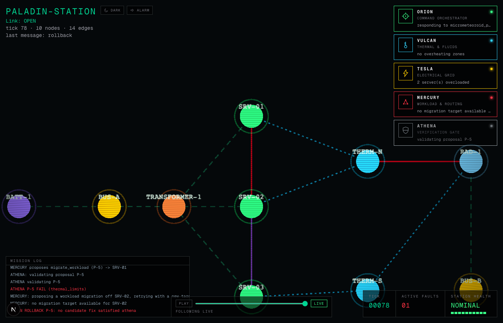

<div align="center">

# Paladin

### An orbital edge-compute facility under fire, five agents keeping it alive

**Project PALADIN is an interactive 2D application simulating PALADIN-Station, an orbital edge-compute facility. When a solar flare, a micrometeoroid puncture, or a cooling breach strikes, five autonomous engineering agents diagnose and fix it live, on a retro sci-fi tactical console, with every fix formally checked before it's applied.**

[](https://github.com/Nabzx/paladin/actions/workflows/ci.yml)
[](LICENSE)



</div>

---

## About

A solar flare spikes a server's load. A micrometeoroid severs a network link. A cooling breach starts cooking a thermal zone. PALADIN-Station runs the physics for all three, and five autonomous agents detect, diagnose, and fix each one live, in front of you, with no human in the loop.

The **Tactical Console** is a zoomable, pannable 2D telemetry grid tracking every power bus, server, thermal zone, and the lines connecting them, rendered in a retro sci-fi style: scanlines, a tuned vignette, a hand-rolled dashed flow animation per connection type, a camera that pans and zooms itself onto whatever just broke. Beside it, the **Operations Deck** streams the five agents' activity in real time: status cards, a mission log, a synthesised alarm klaxon, a cockpit HUD, and a scrub control to rewind and re-watch any incident after the fact.

The five agents:

- **ORION** — Command Orchestrator. Diagnoses, proposes, and turns a verdict into a commit or rollback.
- **VULCAN** — Thermal & Fluids Governor. Runs the thermal physics: ambient dissipation, coolant flow, radiator capacity.
- **TESLA** — Electrical Grid Overseer. Runs the electrical physics: circuit topology, transformer load, battery discharge.
- **MERCURY** — Workload & Network Router. The only agent with an actually implemented remediation action: migrating a workload or rerouting a circuit.
- **ATHENA** — Verification Gate. No fix reaches the station without first passing her validation handshake: a deterministic, rule-based check, across four constraints (power balance, thermal limits, topology connectivity, no secondary cascade), that it won't cause the exact failure it's meant to prevent. A Z3-backed formal upgrade is a scoped, not-yet-built next step, see the parallel research backlog.

This is a long-running personal project, built for its own sake out of genuine interest in distributed systems, multi-agent orchestration, and formal verification, not a one-off exercise tied to a deadline.

**[See it running →](https://paladin-demo.vercel.app)**

See `CONTEXT.md` for the full domain model and `docs/architecture/ARCHITECTURE.md` for the system design.

## Run it locally

Needs [uv](https://docs.astral.sh/uv/) and Node 20+.

```
git clone https://github.com/Nabzx/paladin.git
cd paladin

# Terminal 1: the simulation backend
cd apps/sim
uv run uvicorn paladin_sim.api.main:app --reload

# Terminal 2: the frontend
cd apps/web
cp .env.example .env.local
npm install
npm run dev
```

Open [http://localhost:3000](http://localhost:3000). The Console should show ten nodes, idle, and the status line should read `Link: OPEN`. To see a fault play out end to end, trigger one from a third terminal:

```
curl -X POST http://localhost:8000/faults \
  -H "Content-Type: application/json" \
  -d '{"type": "solar_flare", "node_id": "SRV-01", "severity": "p1"}'
```

Watch the console: a flicker burst, the camera pans and zooms onto `SRV-01`, the five agent cards light up in sequence, the mission log fills in, and the alarm klaxon plays (click anywhere on the page first, browsers block audio before a user gesture). The other two fault types:

```
# a severed power_line or network_link
curl -X POST http://localhost:8000/faults \
  -H "Content-Type: application/json" \
  -d '{"type": "micrometeoroid_puncture", "from_id": "SRV-01", "to_id": "SRV-02", "severity": "p2"}'

# a severed coolant_line
curl -X POST http://localhost:8000/faults \
  -H "Content-Type: application/json" \
  -d '{"type": "cooling_breach", "from_id": "THERM-N", "to_id": "RAD-1", "severity": "p3"}'
```

See `apps/sim/README.md` and `apps/web/README.md` for each service's own details, test commands, and (for the web app) exactly how each visual effect is built.

## Structure

This repository follows a phase-and-wayfinder structure for planning and tracking work. See `AGENTS.md` for the full convention, and `ROADMAP.md` for the current phase table.

## Licence

[MIT](LICENSE).
