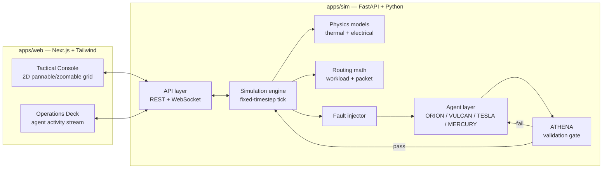

# Architecture

> Status: fully confirmed. Stack and rendering ([ADR-0001](../adr/0001-stack-and-rendering.md)), physical emulation ([ADR-0002](../adr/0002-physical-emulation.md)), routing math ([ADR-0003](../adr/0003-routing-math.md)), and ATHENA's verification model ([ADR-0004](../adr/0004-athena-verification.md)) are all settled. What's below is the Phase 1 blueprint; Phase 2 builds it.

## System overview



A fault perturbs the engine's station graph. The relevant agent (VULCAN, TESLA, or MERCURY) proposes a fix. ORION coordinates if more than one agent is involved. ATHENA is the only one who validates a proposal; ORION takes ATHENA's verdict and either commits the fix to engine state or signals a rollback, it doesn't validate a second time itself. The API layer streams the resulting telemetry and agent activity to the frontend over WebSocket.

## File structure

```
paladin/
├── apps/
│   ├── web/                        # Next.js + Tailwind frontend
│   │   ├── app/                    # routes
│   │   ├── components/
│   │   │   ├── console/            # tactical grid: PixiJS render, pixi-viewport pan/zoom
│   │   │   ├── ops-deck/           # agent stream panel, avatars, mission log
│   │   │   └── ui/                 # shared primitives
│   │   ├── lib/
│   │   │   ├── telemetry/          # client-side state, WebSocket client
│   │   │   └── schemas/            # TS types generated from docs/schemas
│   │   ├── public/
│   │   └── styles/
│   └── sim/                        # FastAPI + Python backend
│       ├── paladin_sim/
│       │   ├── api/                # REST + WebSocket routers
│       │   ├── engine/
│       │   │   ├── grid.py         # station graph: buses, servers, thermal nodes (networkx)
│       │   │   ├── physics/        # thermal diffusion, electrical load models (numpy)
│       │   │   ├── routing/        # workload migration and packet routing math (networkx)
│       │   │   └── faults.py       # fault injection: flare, puncture, breach
│       │   ├── agents/
│       │   │   ├── orion.py
│       │   │   ├── vulcan.py
│       │   │   ├── tesla.py
│       │   │   ├── mercury.py
│       │   │   └── athena/
│       │   │       ├── checker.py  # rule-based safety checker (current)
│       │   │       └── smt/        # candidate Z3 upgrade, research-gated
│       │   ├── protocol/           # agent communication protocol (pydantic models)
│       │   └── sim_loop.py         # fixed-timestep tick
│       ├── tests/
│       └── pyproject.toml
├── docs/
│   ├── architecture/
│   │   └── ARCHITECTURE.md
│   ├── schemas/
│   │   ├── telemetry.schema.json
│   │   ├── agent-protocol.schema.json
│   │   └── README.md
│   ├── research/
│   └── adr/
└── materials/                      # gitignored reference documents
```

## Open questions

None remaining from Phase 1. One constraint carries forward into Phase 2's engine design: ATHENA's no-secondary-cascade check (ADR-0004) needs `sim_loop.py` to support a cheap, disposable one-tick-forward projection.
