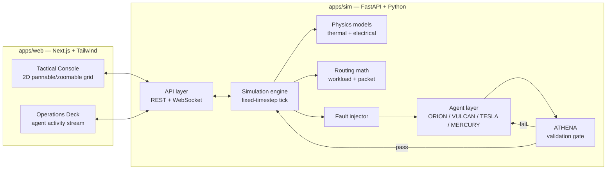

# Architecture

> Status: proposed. The frontend/backend split below follows the brief's suggested stack. It's a working assumption, not yet locked in as an ADR, pending the Phase 1 stack and rendering-engine research ticket.

## System overview



A fault perturbs the engine's station graph. The relevant agent (VULCAN, TESLA, or MERCURY) proposes a fix. ORION coordinates if more than one agent is involved. Every fix passes through ATHENA before the engine applies it. The API layer streams the resulting telemetry and agent activity to the frontend over WebSocket.

## File structure

```
paladin/
├── apps/
│   ├── web/                        # Next.js + Tailwind frontend
│   │   ├── app/                    # routes
│   │   ├── components/
│   │   │   ├── console/            # tactical grid: canvas/WebGL render, pan/zoom
│   │   │   ├── ops-deck/           # agent stream panel, avatars, mission log
│   │   │   └── ui/                 # shared primitives
│   │   ├── lib/
│   │   │   ├── telemetry/          # client-side state, WebSocket client
│   │   │   └── schemas/            # TS types generated from docs/schemas
│   │   ├── public/
│   │   └── styles/
│   └── sim/                        # FastAPI + Python backend
│       ├── paladin_sim/
│       │   ├── api/                # REST + WebSocket routers
│       │   ├── engine/
│       │   │   ├── grid.py         # station graph: buses, servers, thermal nodes
│       │   │   ├── physics/        # thermal diffusion, electrical load models
│       │   │   ├── routing/        # workload migration and packet routing math
│       │   │   └── faults.py       # fault injection: flare, puncture, breach
│       │   ├── agents/
│       │   │   ├── orion.py
│       │   │   ├── vulcan.py
│       │   │   ├── tesla.py
│       │   │   ├── mercury.py
│       │   │   └── athena/
│       │   │       ├── checker.py  # rule-based safety checker (current)
│       │   │       └── smt/        # candidate Z3 upgrade, research-gated
│       │   ├── protocol/           # agent communication protocol (pydantic models)
│       │   └── sim_loop.py         # fixed-timestep tick
│       ├── tests/
│       └── pyproject.toml
├── docs/
│   ├── architecture/
│   │   └── ARCHITECTURE.md
│   ├── schemas/
│   │   ├── telemetry.schema.json
│   │   ├── agent-protocol.schema.json
│   │   └── README.md
│   ├── research/
│   └── adr/
└── materials/                      # gitignored reference documents
```

## Open questions

Tracked as research tickets rather than decided here:

- Stack and 2D rendering engine (frontend canvas/WebGL library, backend host).
- Physical emulation model for thermal and electrical loads.
- Routing and scheduling math for workload migration and packet rerouting.
- Athena's verification model: rule-based now, SMT-backed (for example Z3) later.

See the Phase 1 map issue for the tickets covering each of these.
